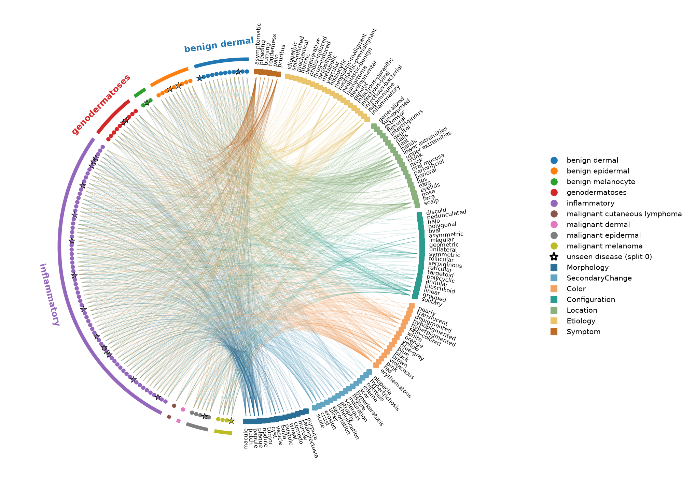

# DermKAP: Knowledge Graph-Structured Attribute Prompts for Zero-Shot Recognition of Unseen Skin Diseases

Official code for **DermKAP** (**Derm**atology **K**nowledge-structured **A**ttribute **P**rompting), submitted to IEEE EMBC 2027.

Skin disease classifiers recognize only the conditions in their training data. DermKAP lets a frozen dermatology foundation model ([MONET](https://huggingface.co/suinleelab/monet)) recognize diseases **without any training images** by turning a curated dermatology knowledge graph (KG) into structured text prompts.

<p align="center">
  
</p>

## Method

1. **Dermatology KG.** Every disease is linked to its primary morphology, secondary changes, color, configuration, location, etiology and symptoms (controlled vocabulary), plus taxonomy, subtype and differential-diagnosis relations. No image data enters the graph.
2. **KG-structured attribute prompts.** Each attribute becomes its own sentence, e.g. *"a clinical photograph of psoriasis, which shows scale"*. An image is matched against every sentence; matches are pooled per relation type with a learned temperature $\tau_r$ and combined with learned relation weights $\omega_r$. Only **23 class-agnostic parameters** are trained, so the scorer transfers unchanged to unseen diseases.
3. **Residual correction for seen diseases.** For generalized zero-shot recognition, a per-disease residual is added on top of the frozen prompt scorer for seen diseases only, so unseen diseases keep their full KG prompt score.
4. **Leakage-free protocol.** 10 class splits (20% of diseases unseen per category), pseudo-unseen validation classes for model selection and calibration, and paired *t*-tests across splits. A **shuffled-KB control** (attributes permuted across diseases) separates the contribution of knowledge from prompt ensembling.

## Results

Fitzpatrick17k, mean over 10 splits, frozen MONET ViT-L/14.

| Method | ZSL BAcc | GZSL $S$ | GZSL $U$ | $H$ | AUSUC |
|---|---|---|---|---|---|
| MONET zero-shot, disease name | 40.1 | 15.2 | 29.1 | 19.6 | 6.9 |
| MONET zero-shot, KG description | 42.0 | 16.2 | 30.0 | 20.9 | 7.5 |
| Residual tuning + KG description | 42.0 | 30.4 | 34.5 | 32.0 | 16.7 |
| Late fusion (residual + prompts) | 44.5 | 31.3 | 36.5 | 33.5 | 17.6 |
| DermKAP, shuffled KB | 44.5 | 37.0 | 30.8 | 33.2 | 17.3 |
| **DermKAP** | **45.9** | **36.8** | **31.3** | **33.6** | **17.6** |

* +5.7 ZSL points over name prompts and +3.9 over a single KG description, better in 10/10 splits ($p<0.001$).
* The correct knowledge adds +1.3 points over the shuffled-KB control in 10/10 splits ($p<0.001$): the gain is not only prompt ensembling.

## Repository structure

```
DermKAP/
├── 01_data_processing.ipynb     # index, integrity check, near-duplicate removal, synonym merge, splits, image cache
├── 02_kg_build.ipynb            # build the KG from dermkb.csv (no image data)
├── 03_feature_extraction.ipynb  # frozen MONET / CLIP / DINOv2 image and text features
├── 04_train_eval.ipynb          # (legacy) R-GCN classifier generation, v1
├── 04_train_eval_v2.ipynb       # (legacy) KG knowledge transfer, v2; also draws the KG figures
├── 05_attribute_prompts.ipynb   # DermKAP prompt scorer, prompt baselines, shuffled KB, ablations
├── 06_full_model.ipynb          # DermKAP full model (prompts + residual), GZSL comparison
├── dermkb.csv                   # curated dermatology knowledge base (required)
├── requirements.txt
└── LICENSE
```

Generated folders (not tracked): `data_v2/`, `models/`, `results_v2*/`, `figures_v2*/`.

## Installation

Python 3.11 is recommended (PyTorch has no wheels for very new Python versions yet).

```bash
conda create -n dermkap python=3.11 -y
conda activate dermkap
# GPU (CUDA 12.8+, required for RTX 50-series); use a CPU build otherwise
pip install torch torchvision --index-url https://download.pytorch.org/whl/cu128
pip install -r requirements.txt
```

## Data and weights

| Item | Source | Location |
|---|---|---|
| `fitzpatrick17k.csv` | [Fitzpatrick17k](https://github.com/mattgroh/fitzpatrick17k) | repository root |
| Fitzpatrick17k images | request from the dataset authors (many original URLs are broken) | `images/` |
| MONET | [suinleelab/monet](https://huggingface.co/suinleelab/monet) | `models/monet/` |
| CLIP ViT-L/14 (optional baseline) | [openai/clip-vit-large-patch14](https://huggingface.co/openai/clip-vit-large-patch14) | `models/clip-vit-large-patch14/` |
| DINOv2 ViT-L/14 (optional baseline) | [facebook/dinov2-large](https://huggingface.co/facebook/dinov2-large) | `models/dinov2-large/` |

`03` downloads missing weights automatically (through `hf-mirror.com` by default; set `HF_ENDPOINT = None` to use huggingface.co). If the download fails, fetch the `*.json`, `*.txt` and `model.safetensors` files manually into the folders above.

## Quick start

Run the notebooks in order:

```text
01_data_processing.ipynb     ->  data_v2/
02_kg_build.ipynb            ->  data_v2/kg/
03_feature_extraction.ipynb  ->  data_v2/features/
05_attribute_prompts.ipynb   ->  results_v2c/, figures_v2c/
06_full_model.ipynb          ->  results_v2e/, figures_v2e/
```

`04_train_eval_v2.ipynb` is only needed for the KG visualizations (`figures_v2b/figKG*`). Every training notebook has `QUICK = True` for a fast end-to-end check and is resumable: finished runs are skipped on restart. Feature extraction takes a few minutes per backbone on an RTX 5070; all training then runs on cached features.

## Citation

```bibtex
@inproceedings{dermkap2027,
  title     = {{DermKAP}: Knowledge Graph-Structured Attribute Prompts for Zero-Shot Recognition of Unseen Skin Diseases},
  booktitle = {Proc. IEEE Engineering in Medicine and Biology Conference (EMBC)},
  year      = {2027}
}
```

Please also cite [Fitzpatrick17k](https://github.com/mattgroh/fitzpatrick17k) and [MONET](https://doi.org/10.1038/s41591-024-02887-x).

## License

Code and `dermkb.csv` are released under the MIT License. Fitzpatrick17k is licensed CC BY-NC-SA 3.0 for non-commercial research; this repository does not redistribute any images. The knowledge base was curated from dermatology references and has not yet been reviewed by an independent dermatologist panel; it is intended for research, not clinical use.
